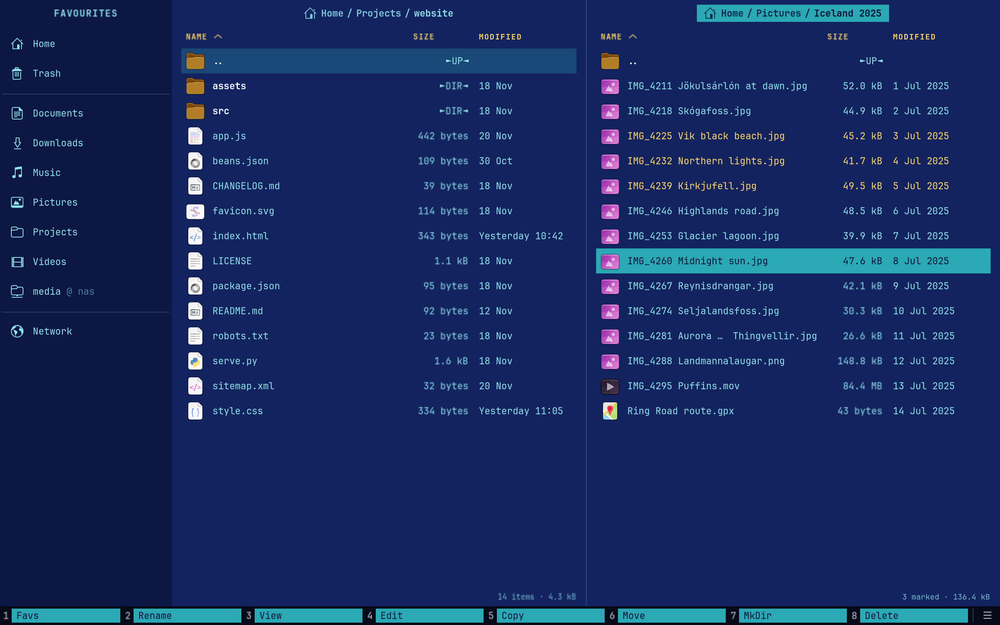
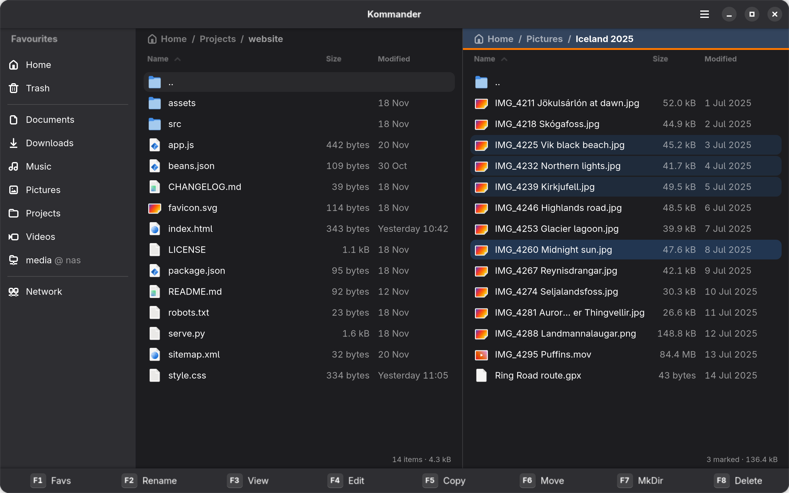
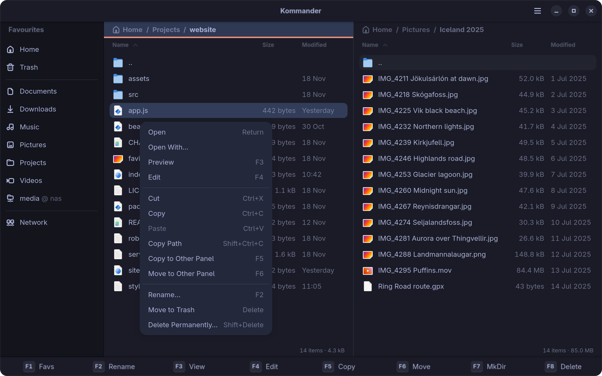
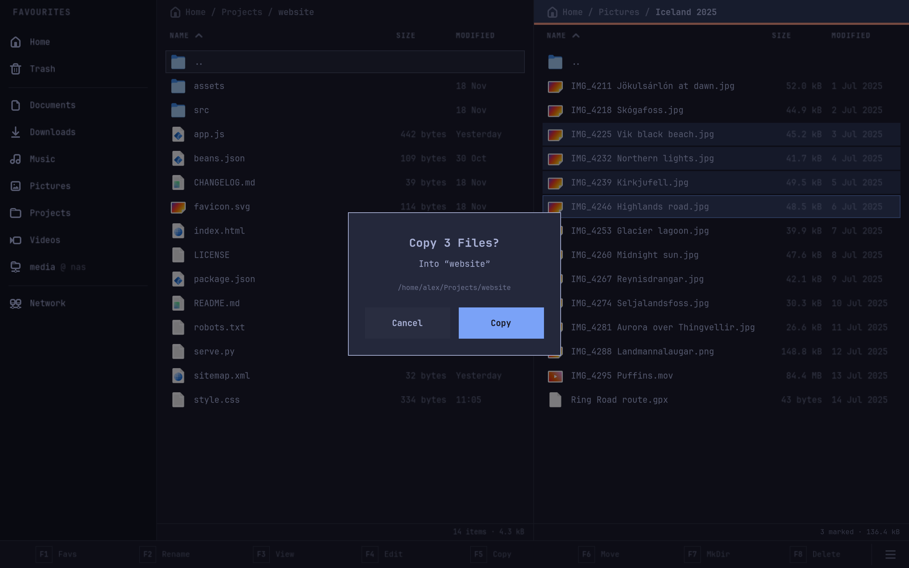

# Kommander

Two panels. Function keys. No mouse required.

Kommander is a file manager for people who miss Norton Commander but like
how GNOME Files looks. Copy with F5, move with F6, preview with F3 in the
other panel. It talks to your NAS, follows your Omarchy theme the moment
you switch it, and otherwise stays out of your way.


| | |
| --- | --- |
|  |  |
|  |  |
|  |  |
|  |  |

## Features

- **Two panels** side by side with a draggable split, or just one (Ctrl+1); Tab or arrows switch
- **Copy (F5) and move (F6)** to the other panel, in the background, with progress and a queue
- **Asks before replacing** a file: skip, replace or keep both
- **Rename (F2), new folder (F7), trash (F8)** with Undo, delete for good (Shift+F8)
- **Mark files** with Space or Insert, then act on all of them at once
- **Preview (F3)** in the other panel that follows the cursor
- **Previews** images, highlighted code and text, PDF, video and sound
- **Favourites sidebar (F1)** with the same bookmarks as GNOME Files
- **Drives and USB sticks** in the sidebar, with an eject button
- **Network list** of the computers and shares found around you
- **Connect to Server** for smb, sftp, ftp and dav; remembers the last eight
- **Zip and unzip** from the right-click menu: Compress… and Extract Here, also on shares
- **Your editor (F4)** in a floating window on Hyprland, Open With, and a terminal (Shift+F4)
- **Cut, copy and paste** files, also to and from GNOME Files
- **Drag and drop** between the panels and with other apps
- **Type a path** (Ctrl+L) with Tab completion, or type a name to jump to it
- **Copy a path** with Ctrl+Shift+C or a double-click on the path strip
- **Slow or dropped shares**: a spinner while waiting, reconnects by itself, Escape goes back
- **Three looks**: GNOME, Omarchy's own square style, or Norton Commander blue
- **Omarchy theme** followed live, light and dark, and an optional see-through window

## Install

On Arch / Omarchy:

```
sudo pacman -S --needed git rust pkgconf gtk4 libadwaita gtksourceview5 poppler-glib
git clone https://github.com/sebastianknopp/kommander.git
cd kommander && ./install.sh
```

For your user only, no sudo. `./uninstall.sh` removes it.

Every key is in the app under Ctrl+?. That's the manual.

## Extras

Optional packages:

- `gst-plugins-good gst-libav` for video and sound preview
- `gvfs-dnssd gvfs-wsdd` to find computers on your network
- `sushi` to preview in a separate window

Super+Shift+F for Kommander instead of GNOME Files, in
`~/.config/hypr/bindings.lua`:

```lua
o.rebind("SUPER + SHIFT + F", "File manager", { launch = "kommander" })
o.rebind("SUPER + ALT + SHIFT + F", "File manager (cwd)", [[uwsm-app -- kommander "$(omarchy-cmd-terminal-cwd)"]])
```

Something broke? The error message has a Details button with a Copy
button. Paste that into an issue.

## License

GPL-3.0-or-later. The name is a nod to Norton Commander and the German film
"Superstau".
