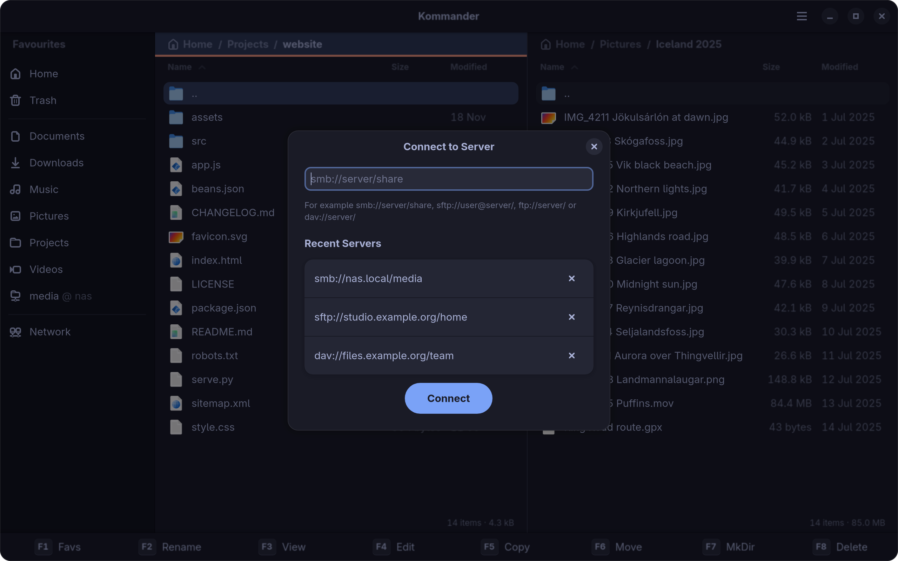

# Kommander

A two-panel file manager for Linux, in the tradition of Norton Commander
with the look of GNOME Files. Made for [Omarchy](https://omarchy.org); runs
on any desktop with GTK 4 and libadwaita.


- **Two panels, keyboard first:** F5 copy, F6 move, F7 new folder, F8 delete, Space marks.
- **Preview** in the other panel (F3): images, code, PDF, video, sound.
- **Favourites and network:** bookmarks, drives, smb/sftp/ftp/dav shares.
- **Background copy and move** with progress; trash with Undo.
- **Two looks:** follows your Omarchy theme live, or plain GNOME, light and dark.

| | |
| --- | --- |
|  |  |
|  |  |
|  |  |

## Install

On Arch / Omarchy:

```
sudo pacman -S --needed git rust pkgconf gtk4 libadwaita gtksourceview5 poppler-glib
git clone https://github.com/sebastianknopp/kommander.git
cd kommander
./install.sh
```

Installs for your user only (no sudo); `./uninstall.sh` removes it.

## More

All features, keys and set-up notes: [docs/manual.md](docs/manual.md).
Written in Rust. GPL-3.0-or-later, see [LICENSE](LICENSE).
