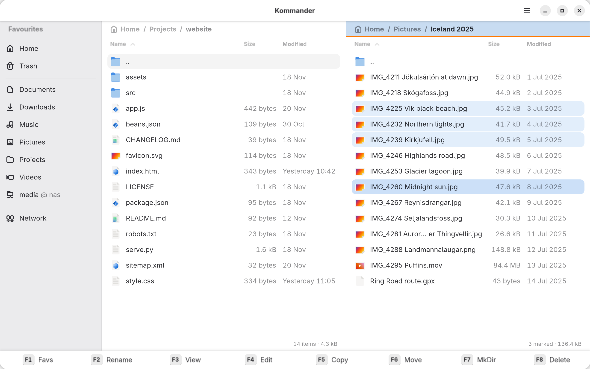
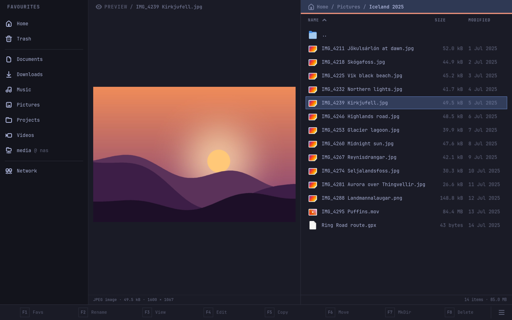
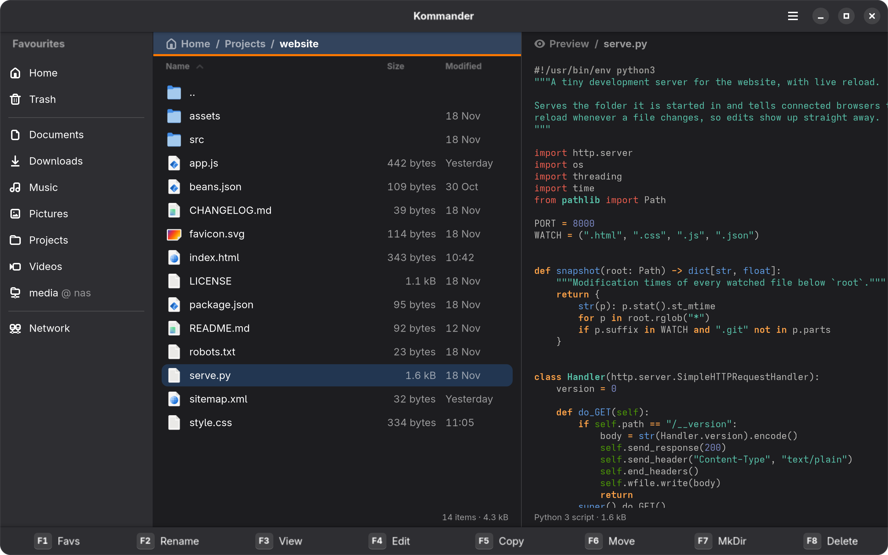

# Kommander

A two-panel file manager for Linux, in the tradition of Norton Commander
with the look of GNOME Files. Made for [Omarchy](https://omarchy.org); runs
on any desktop with GTK 4 and libadwaita.


| | |
| --- | --- |
|  |  |
|  |  |
|  |  |

## Features

- **Two panels, keyboard first.** Copy, move, rename, new folder, trash
  (with Undo) and delete on the function keys; Space marks files.
- **Preview** (F3) in the other panel, following the cursor: images, text
  and code, PDF, video, sound.
- **Favourites** (F1): the bookmarks of GNOME Files, drives with eject,
  drag folders in to add them.
- **Network:** lists the computers it finds; Connect to Server takes smb,
  sftp, ftp and dav addresses and remembers them.
- **Copy and move in the background** with progress, a queue and a
  question when a file already exists.
- **Right-click menu, clipboard, drag and drop**, also to and from GNOME
  Files and other apps. Open With, Copy Path, Open Terminal Here.
- **Go anywhere:** type a path (Ctrl+L, Tab completes), or type a name to
  jump to it.
- **Slow and remote folders:** a spinner with Esc to go back; Ctrl+R
  reloads.
- **Two looks:** follows the Omarchy theme live, or plain GNOME; light and
  dark; optional see-through window.
- Remembers folders, sorting, window size and recent servers.

## Keys

All keys are also in the app: Main Menu > Keyboard Shortcuts (Ctrl+?).

| Key | What it does |
| --- | --- |
| Tab | Other panel |
| Enter, Backspace | Open; parent folder |
| F1 | Favourites sidebar |
| F2 | Rename |
| F3 | Preview (Ctrl+Space pauses video and sound) |
| F4, Shift+F4 | Edit in the text editor; terminal here |
| F5, F6 | Copy, move to the other panel |
| F7 | New folder |
| F8, Shift+F8 | Trash; delete permanently |
| Space or Insert | Mark; Ctrl+A marks all, Ctrl+Shift+A none |
| Ctrl+X, Ctrl+C, Ctrl+V | Cut, copy, paste |
| Ctrl+Shift+C | Copy the path |
| Ctrl+L | Type a path |
| Ctrl+H, Ctrl+R | Hidden files; reload |
| Ctrl+D | Add the folder to the favourites |
| Ctrl+J | Running copies and moves |
| Menu or Shift+F10 | Right-click menu |
| Any letter | Jump to a name |

## Install

On Arch / Omarchy:

```
sudo pacman -S --needed git rust pkgconf gtk4 libadwaita gtksourceview5 poppler-glib
git clone https://github.com/sebastianknopp/kommander.git
cd kommander
./install.sh
```

Installs for your user only, no sudo. Run it again to update;
`./uninstall.sh` removes it. Settings are in
`~/.config/kommander/settings.ini`.

Optional packages:

- `gst-plugins-good gst-libav`: video and sound preview (sound plays from
  local folders only)
- `gvfs-dnssd gvfs-wsdd`: finding computers on the network (log out and in
  once)
- `sushi`: preview in a separate window instead of the other panel

## Use

```
kommander                             # panels open where you left them
kommander ~/Downloads ~/Documents     # left and right panel
kommander ~/Documents/letter.pdf      # its folder, cursor on the file
```

It runs once: a second `kommander some/folder` sends the open window there.

As the file manager for folders everywhere:

```
xdg-mime default io.github.sebastianknopp.kommander.desktop inode/directory
```

## On Omarchy

- **Colours** come from the current theme and change with it. Preferences >
  Colours > GNOME keeps the plain look.
- **See-through window:** Preferences > Translucent Window. No Hyprland
  change needed.
- **Super+Shift+F** for Kommander instead of GNOME Files: add to
  `~/.config/hypr/bindings.lua`

  ```lua
  o.rebind("SUPER + SHIFT + F", "File manager", { launch = "kommander" })
  o.rebind("SUPER + ALT + SHIFT + F", "File manager (cwd)", [[uwsm-app -- kommander "$(omarchy-cmd-terminal-cwd)"]])
  ```

## If something goes wrong

Error messages have a **Details** button with the full story and a **Copy**
button, ready for a bug report. All errors are also under Main Menu > Show
Error Log (`~/.local/state/kommander/kommander.log`).

## Not yet

Search in subfolders, tabs, folder compare and sync, looking inside
archives, renaming many files at once, undo for copy and move.

## Licence

Written in Rust. GPL-3.0-or-later, see [LICENSE](LICENSE).
