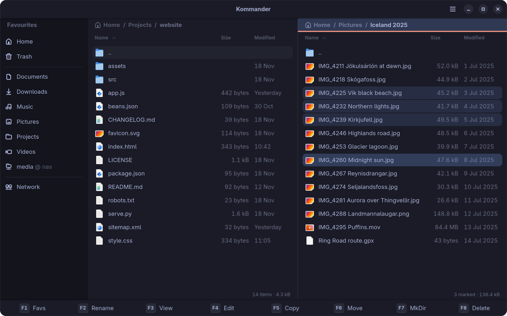

# Kommander

Two panels. Function keys. No mouse required.

Kommander is a file manager for people who miss Norton Commander but like
how GNOME Files looks. Copy with F5, move with F6, preview with F3 in the
other panel. It talks to your NAS, follows your Omarchy theme the moment
you switch it, and otherwise stays out of your way.



| | |
| --- | --- |
|  |  |

## Install

On Arch / Omarchy:

```
sudo pacman -S --needed git rust pkgconf gtk4 libadwaita gtksourceview5 poppler-glib
git clone https://github.com/sebastianknopp/kommander.git
cd kommander && ./install.sh
```

For your user only, no sudo. `./uninstall.sh` removes it.

Every key is in the app under Ctrl+?. That's the manual.

## Extras

Optional packages:

- `gst-plugins-good gst-libav` for video and sound preview
- `gvfs-dnssd gvfs-wsdd` to find computers on your network
- `sushi` to preview in a separate window

Super+Shift+F for Kommander instead of GNOME Files, in
`~/.config/hypr/bindings.lua`:

```lua
o.rebind("SUPER + SHIFT + F", "File manager", { launch = "kommander" })
o.rebind("SUPER + ALT + SHIFT + F", "File manager (cwd)", [[uwsm-app -- kommander "$(omarchy-cmd-terminal-cwd)"]])
```

Something broke? The error message has a Details button with a Copy
button. Paste that into an issue.

## License

GPL-3.0-or-later. The name is a nod to Norton Commander and the German film
"Superstau".
